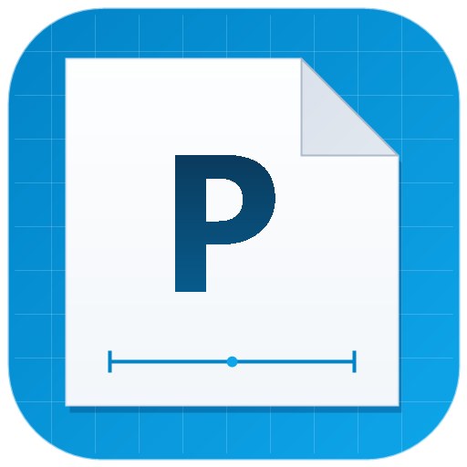
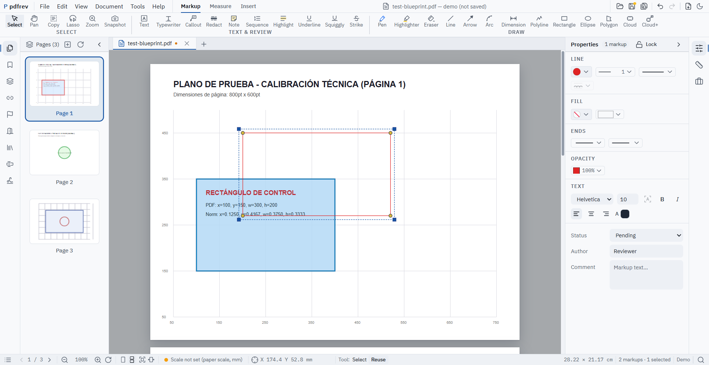
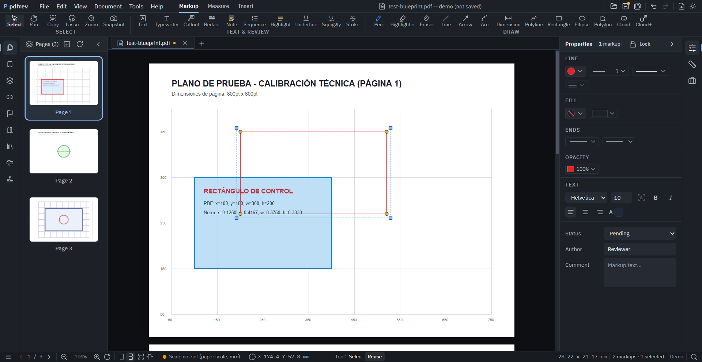
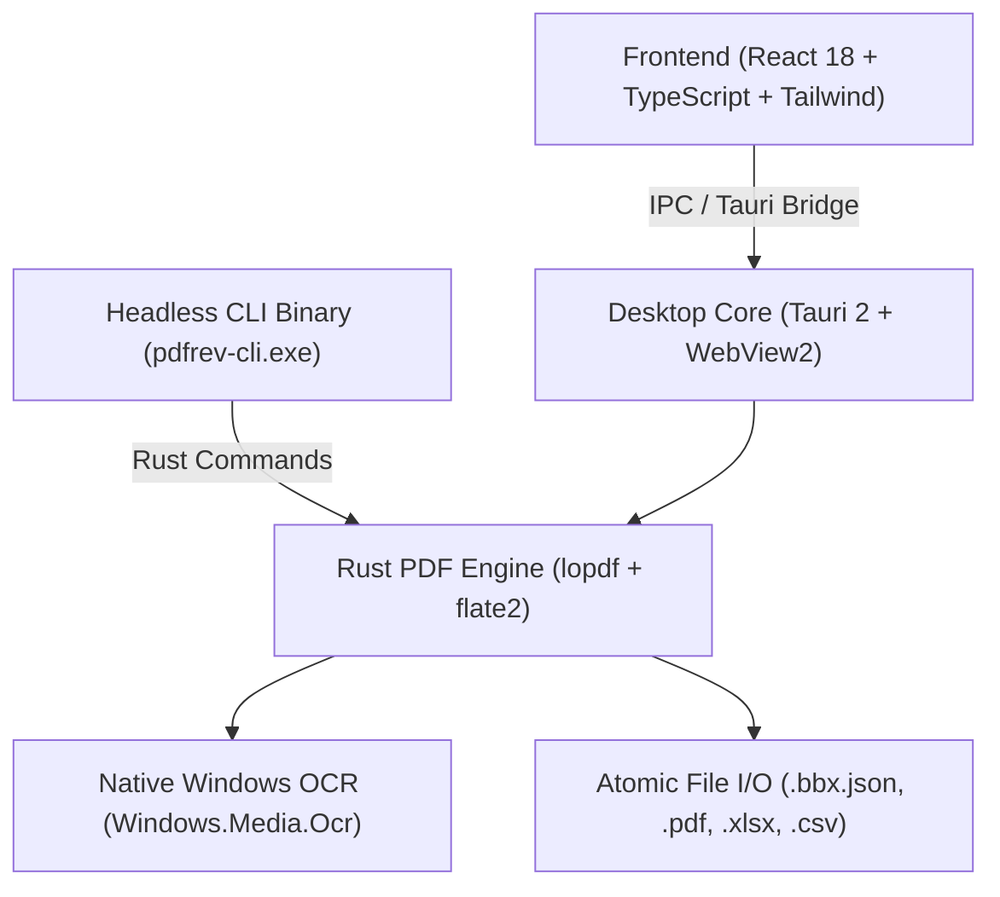

<p align="center">
  
</p>

<h1 align="center">pdfrev</h1>

<p align="center">
  <strong>Local-first, fearless PDF editing, drawing takeoff, and AI-agent automation.</strong>
</p>

<p align="center">
  <a href="https://github.com/jacobavina/pdfrev/actions/workflows/ci.yml"></a>
  <a href="https://github.com/jacobavina/pdfrev/releases/latest"></a>
  <a href="LICENSE"></a>
  <a href="#"></a>
  <a href="#"></a>
</p>

---

**pdfrev** is an ultra-fast, local-first PDF viewer, editor, and drawing takeoff workstation built for architecture, engineering, and construction professionals—and designed from day one to be driven programmatically by **AI coding and reasoning agents**.

Built with **Tauri 2**, **Rust**, and modern **React**, pdfrev provides a native Windows experience with instant startup, 60 FPS panning on dense E-size blueprint drawings, zero telemetry, and seamless interoperability with Bluebeam Revu and Adobe Acrobat.

---

## ⚡ Highlights

- **🔒 Local-First & Zero Telemetry:** Your drawings and documents never leave your workstation. No cloud logins, no mandatory sync, no background tracking.
- **📐 Precision Drawing Takeoff:** Real-world scale calibration, Area with multi-polygon Cutout subtraction, Perimeter, Volume, Dynamic Length, and autonomous shape Count takeoff.
- **🔄 Full Bluebeam Revu Interoperability:** Native roundtrip markup editing, `.bbx.json` sidecar storage, standard `/Annots` (`/Square`, `/Circle`, `/Highlight`, `/Ink`, `/Stamp`), status tracking, and threaded comment replies.
- **🤖 Headless AI Agent CLI (`pdfrev-cli`):** First-class command-line interface for LLMs and autonomous agents to split, combine, inspect markups, extract text, and perform OCR with structured JSON output and standardized POSIX exit codes.
- **🔍 Windows Native OCR:** Offline text recognition powered directly by `Windows.Media.Ocr`. Zero external models, zero downloads, completely private.
- **🎨 Cyanotype Blueprint Aesthetic:** Refined interface with both Light and Dark themes engineered around drawing readability.

---

## 📸 Screenshots

### Light Mode (Drawing Hall Blueprint Theme)


### Dark Mode (Night Workstation Theme)


---

## 🤖 Headless CLI for AI Agents

`pdfrev` includes a dedicated console binary (`pdfrev-cli.exe` or `pdfrev --headless`) designed specifically for AI workflows, automated takeoff pipelines, and background processing. All commands support `--json` output.

### CLI Commands Matrix

| Command | Description | Example |
|---|---|---|
| `split` | Split a PDF into chunks of N pages | `pdfrev split blueprint.pdf --every 1 --out-dir ./pages --json` |
| `combine` | Merge multiple PDFs in order into one | `pdfrev combine p1.pdf p2.pdf --output full.pdf --json` |
| `extract-text` | Extract plain text from all or specific pages | `pdfrev extract-text doc.pdf --page 1 --json` |
| `markups list` | Extract all markups and annotations | `pdfrev markups list blueprint.pdf --json` |
| `ocr` | Perform Windows native OCR on images or scans | `pdfrev ocr scan.png --output ocr.txt --json` |

### Sample JSON Output

```bash
pdfrev --json markups list plan.pdf
```

```json
{
  "input": "plan.pdf",
  "total_markups": 2,
  "markups": [
    {
      "page": 1,
      "subtype": "Square",
      "author": "Architect",
      "contents": "Verify HVAC shaft clearance",
      "rect": [140.5, 320.0, 290.0, 480.5],
      "modified": "D:20261015143000Z"
    },
    {
      "page": 1,
      "subtype": "Highlight",
      "author": "Structural Eng",
      "contents": "Reinforced beam W24x68",
      "rect": [420.0, 610.0, 580.0, 630.0],
      "modified": "D:20261015150000Z"
    }
  ]
}
```

---

## 🏗️ Architecture



- **Frontend:** React 18, TypeScript, Tailwind CSS, Lucide Icons, PDF.js rendering pipeline.
- **Desktop Bridge:** Tauri 2 with strict boundary validation and atomic backups.
- **Rust Core:** `lopdf` PDF dictionary and xref stream manipulation, native memory safety.
- **Headless Engine:** `clap` CLI subcommands returning structured JSON for AI consumption.

---

## 📥 Download & Installation (Windows x64)

### Option 1: Official NSIS Installer (Recommended)
Download the latest `pdfrev_<version>_x64-setup.exe` from the [Releases](https://github.com/jacobavina/pdfrev/releases/latest) page and run the installer.

### Option 2: Portable Package
Download `pdfrev_<version>_windows_x64_portable.zip`, extract to any directory, and launch `pdfrev.exe` (GUI) or `pdfrev-cli.exe` (CLI).

---

## 🛠️ Building from Source

### Prerequisites
- [Node.js](https://nodejs.org/) (v20.x or v22.x LTS)
- [Rust](https://www.rust-lang.org/) (v1.85+ with `cargo`)
- Windows 10 or 11 with C++ Build Tools installed

```powershell
# 1. Clone repo
git clone https://github.com/jacobavina/pdfrev.git
cd pdfrev

# 2. Install dependencies
npm install

# 3. Build and verify all automated test suites
node scripts/verify.mjs

# 4. Compile the production installer
npx tauri build --bundles nsis
```

The compiled binaries and NSIS setup executable will be located in `src-tauri/target/release/bundle/nsis/`.

---

## 🧪 Quality Gates & Test Coverage

`pdfrev` enforces a strict automated quality gate before any release:
- **1,400+ Unit Tests** (Vitest) covering geometry, takeoff mathematics, stamp rendering, and tool pipelines.
- **Native Rust Tests** (`cargo test`) verifying atomic disk I/O, backup rollbacks, PDF stream parsing, and Windows OCR.
- **Bundle Size Enforcement:** Main chunk strictly capped under 800 kB.
- **PARITY Verification:** Automatic checks ensuring complete compliance with Bluebeam Revu drawing standards.

```powershell
node scripts/verify.mjs
```

---

## 📄 License

This project is licensed under the [MIT License](LICENSE).
Icons and typography attributions are documented in detail in [ATTRIBUTION.md](ATTRIBUTION.md).
