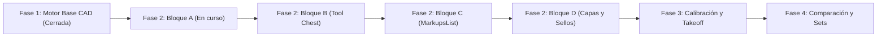

# ROADMAP.md — Plan Maestro de Fases, Bloques e Hitos de REA

Este documento establece la hoja de ruta técnica estructurada por fases e hitos identificables (`P<Fase>-<Bloque>.<Hito>`).

---

## Estado Global del Proyecto

---

## Fase 1: Motor Base y Shell CAD (CERRADA Y VERIFICADA)

- `P1-0.1` — Visor PDF con worker web dinámico PDF.js por URL (`?url`) y canvas offscreen. **[CERRADO]**
- `P1-0.2` — Figuras geométricas básicas (círculo, polígono) y cancelación con `Escape`. **[CERRADO]**
- `P1-0.3` — Exportación vectorial a PDF con pdf-lib e inspección de content stream binario. **[CERRADO]**
- `P1-0.4` — Persistencia atómica `.bbx.json` con comandos Rust (`write_bbx`, `read_bbx`, `.tmp` + `sync_all`). R9 verificado por el usuario. **[CERRADO]**
- `P1-0.5` — Rotación unificada de Viewport (0°, 90°, 180°, 270°) combinando `page.rotate` y store. **[CERRADO]**
- `P1-0.6` — Hit-testing matemático riguroso para los 14 tipos de marcas reconocidos (0 caídas a `return true`). **[CERRADO]**
- `P1-0.7` — Gestor de Historial Command con tope estricto de 50 pasos para undo y redo. **[CERRADO]**

---

## Fase 2: Herramientas Técnicas de Marcado y Manipulación (EN CURSO)

### Bloque A: Marcado Técnico y Manipulación Interactiva

| ID | Hito | Estado | Dependencia |
|---|---|---|---|
| `P2-A.0` | Move y Transform con umbral 4px, clamp estricto `[0..1]` y undo atómico | **CERRADO** (commit `6e7f0e3`) | Fase 1 |
| `P2-A.1` | Nubes de revisión con `arcStep` persistido, abombamiento determinista y Cloud+ como grupo | **CERRADO** (commit `b2ee813`) | `P2-A.0` |
| `P2-A.2` | Multiselección con Marquee por intersección y traslación conjunta con undo atómico | **CERRADO** (commit `d525990`) | `P2-A.1` |
| `P2-A.3` | Callout / Nota técnica con directriz conectada y cuadro de texto plano | **PENDIENTE DE PLAN** | `P2-A.2` |
| `P2-A.4` | Nota adhesiva técnica (`stickyNote`) | **NO EMPEZADO** | `P2-A.3` |
| `P2-A.5` | Resaltador vectorial (`highlightVector`) | **NO EMPEZADO** | `P2-A.4` |
| `P2-A.6` | Resaltado de texto (`highlightText` con TextLayer de PDF.js, rectángulos normalizados y aviso en páginas sin capa de texto) | **NO EMPEZADO** | `P2-A.5` |

> [!NOTE]
> **Hito Futuro `P2-X` (Automatización de Ventana Nativa con `tauri-driver`):**
> Integración de WebDriver para pruebas automatizadas directamente sobre la ventana nativa de Tauri. Marcado explícitamente como **posterior al Bloque A**. No forma parte del alcance actual de la Fase 2 y se regirá por su propio `ADR-0007`.

---

### Bloque B: Tool Chest

| ID | Hito | Estado | Dependencia |
|---|---|---|---|
| `P2-B.1` | Almacenamiento y persistencia de paletas de estilos en IndexedDB | **NO EMPEZADO** | Bloque A completo |
| `P2-B.2` | Modos de herramienta: Modo Propiedad y Modo Dibujo | **NO EMPEZADO** | `P2-B.1` |
| `P2-B.3` | Interacción de arrastrar y soltar (drag & drop) de estilos y herramientas directamente al lienzo | **NO EMPEZADO** | `P2-B.2` |

---

### Bloque C: MarkupsList Completa

| ID | Hito | Estado | Dependencia |
|---|---|---|---|
| `P2-C.1` | Ordenación bidireccional y filtrado multicriterio (estado, autor, tipo, capa) | **NO EMPEZADO** | Bloque B completo |
| `P2-C.2` | Columnas personalizadas con parser propio de lista blanca y validación | **NO EMPEZADO** | `P2-C.1` |
| `P2-C.3` | Transición de estados con menú contextual interactivo | **NO EMPEZADO** | `P2-C.2` |
| `P2-C.4` | Exportación de reportes estructurados con hipervínculos en PDF más hojas en Excel y CSV | **NO EMPEZADO** | `P2-C.3` |

---

### Bloque D: Capas Lógicas y Sellos Dinámicos

| ID | Hito | Estado | Dependencia |
|---|---|---|---|
| `P2-D.1` | Capas CAD lógicas con visibilidad persistida en el modelo `.bbx.json` | **NO EMPEZADO** | Bloque C completo |
| `P2-D.2` | Sellos dinámicos técnicos basados en primitivas vectoriales limpias | **NO EMPEZADO** | `P2-D.1` |

---

## Fases Futuras

### Fase 3: Calibración, Acotación, Takeoff y Estimación de Costes
- `P3-0.1` — Calibración de escala de plano sobre segmento conocido.
- `P3-0.2` — Acotación lineal, perimetral y superficial en escala real de ingeniería.
- `P3-0.3` — Conteo automático de símbolos y etiquetas técnicas.
- `P3-0.4` — Tablas de cubicación y takeoff de materiales con costes unitarios.
- `P3-0.5` — Exportación estructurada avanzada a Excel (`.xlsx`) y CSV.

### Fase 4: Comparación Diferencial y Juegos de Planos (Sets)
- `P4-0.1` — Superposición de planos (Overlay Pages) con código cromático de diferencias.
- `P4-0.2` — Comparación lado a lado con Split View y paneo sincronizado.
- `P4-0.3` — Gestión de conjuntos de planos (Document Sets) con vinculación de hiperenlaces.
