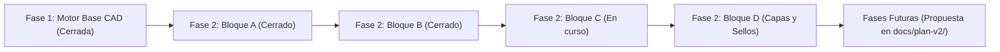

# ROADMAP.md — Plan Maestro de Fases, Bloques e Hitos de REA

Este documento establece la hoja de ruta técnica estructurada por fases e hitos identificables (`P<Fase>-<Bloque>.<Hito>`).

---

## Estado Global del Proyecto

---

## Fase 1: Motor Base y Shell CAD (CERRADA Y VERIFICADA)

- `P1-0.1` — Visor PDF con worker web dinámico PDF.js por URL (`?url`) y canvas offscreen. **[CERRADO]**
- `P1-0.2` — Figuras geométricas básicas (círculo, polígono) y cancelación con `Escape`. **[CERRADO]**
- `P1-0.3` — Exportación vectorial a PDF con pdf-lib e inspección de content stream binario. **[CERRADO]**
- `P1-0.4` — Persistencia atómica `.bbx.json` con comandos Rust (`write_bbx`, `read_bbx`, `.tmp` + `sync_all`). R9 verificado por el usuario. **[CERRADO]**
- `P1-0.5` — Rotación unificada de Viewport (0°, 90°, 180°, 270°) combinando `page.rotate` y store. **[CERRADO]**
- `P1-0.6` — Hit-testing matemático riguroso para los 14 tipos de marcas reconocidos (0 caídas a `return true`). **[CERRADO]**
- `P1-0.7` — Gestor de Historial Command con tope estricto de 50 pasos para undo y redo. **[CERRADO]**

---

## Fase 2: Herramientas Técnicas de Marcado y Manipulación (EN CURSO)

### Bloque A: Marcado Técnico y Manipulación Interactiva (CERRADO)

| ID | Hito | Estado | Dependencia |
|---|---|---|---|
| `P2-A.0` | Move y Transform con umbral 4px, clamp estricto `[0..1]` y undo atómico | **CERRADO** (commit `6e7f0e3`) | Fase 1 |
| `P2-A.1` | Nubes de revisión con `arcStep` persistido, abombamiento determinista y Cloud+ como grupo | **CERRADO** (commit `b2ee813`) | `P2-A.0` |
| `P2-A.2` | Multiselección con Marquee por intersección y traslación conjunta | **CERRADO** (commit `d525990`) | `P2-A.1` |
| `P2-A.3` | Callout / Nota técnica con directriz conectada y cuadro de texto plano | **CERRADO** (commit `083a37b`) | `P2-A.2` |
| `P2-A.4` | Nota adhesiva técnica (`stickyNote`) | **CERRADO** (commit `75fd7be`) | `P2-A.3` |
| `P2-A.5` | Resaltador vectorial (`highlightVector`) | **CERRADO** (commit `8ffdb81`) | `P2-A.4` |
| `P2-A.6` | Resaltado de texto (`highlightText` con TextLayer de PDF.js) | **CERRADO** (commit `f895824`) | `P2-A.5` |

> [!NOTE]
> **Hito `P2-X` (Automatización de Ventana Nativa con `tauri-driver`):**
> Integración de WebDriver para pruebas automatizadas directamente sobre la ventana nativa de Tauri (`ADR-0008`). **[CERRADO y verificado en frío]**: Smoke test autocontenido en `scripts/native-smoke.mjs` (`npm run test:native`), verificando arranque, render de canvas, IPC real de Rust y acciones W3C. Ejecutable opcionalmente en la puerta de calidad mediante `verify.mjs --with-native`.

---

### Bloque B: Tool Chest (CERRADO Y VERIFICADO POR EL USUARIO)

| ID | Hito | Estado | Dependencia |
|---|---|---|---|
| `P2-B.1` | Almacenamiento y persistencia de paletas en IndexedDB (`fake-indexeddb`, migración v1->v2) | **CERRADO** (commit `d48d132`) | Bloque A completo |
| `P2-B.2` | Modos de herramienta: Modo Propiedad (P) y Modo Dibujo (D) con comando atómico | **CERRADO** (commit `0edeaa3`) | `P2-B.1` |
| `P2-B.3` | Miniaturas vectoriales canónicas (`ToolVectorThumbnail` vía render canónico) | **CERRADO** (commit `0edeaa3`) | `P2-B.2` |
| `P2-B.4` | Panel lateral Tool Chest y botón contextual en MarkupsList | **CERRADO** (commit `d42dc3b`) | `P2-B.3` |
| `P2-B.5` | Drag & drop al lienzo con centrado $\le 5\text{ px}$ y `dragDropEnabled: false` | **CERRADO** (commit `c618b34`, verificado por el usuario) | `P2-B.4` |

---

### Bloque C: MarkupsList Completa e Inspector (EN CURSO - CIERRE FASE 2, D-2 Y D-3)

| ID | Hito | Estado | Dependencia |
|---|---|---|---|
| `P2-C.1` | Ordenación bidireccional y filtrado multicriterio con benchmark < 10ms | **CERRADO** (commit `d3b8d55`); verificación nativa pendiente | Bloque B completo |
| `P2-C.2` | Menú contextual de estados técnicos con comando atómico y sincronización de grupos | **CERRADO** (commit `d310a87`); verificación nativa pendiente | `P2-C.1` |
| `P2-C.3` | Columnas personalizadas con parser de gramática cerrada, evaluador y persistencia | **CERRADO** (commit `bc8defd`, ADR-0009) | `P2-C.2` |
| `P2-C.4` | Exportación CSV (RFC 4180 + BOM) y Reporte Resumen PDF con I/O atómico Rust | **En curso** | `P2-C.3` |
| `P2-C.6` | Inspector de propiedades de marca (D-3, ADR-0012) | **En curso** | `P2-C.4` |
| `P2-C.5` | E2E del bloque completo, atajo Ctrl+S y verificación nativa | **En curso** | `P2-C.6` |

---

### Bloque D: Capas Lógicas y Sellos Dinámicos
*Reubicado a Fase 3 (Bloque G) conforme a la decisión **D-2 (Camino A′)** para construirse sobre OCGs estándar y XObjects de apariencia en PDF.*

---

## Fases Futuras (Plan Maestro v2 Aprobado)

### Fase 3: Interoperabilidad PDF Real, Motor y Herramientas Revu (ADR-0011, D-1)
- Persistencia de marcas como anotaciones PDF estándar ISO 32000-1 con `/AP` (el PDF es la fuente de verdad).
- Escritura incremental en disco (append-only) que preserva 100% los bytes originales.
- Comando Rust `save_pdf` atómico con respaldo y validación estructural previa.
- Importación bidireccional de anotaciones PDF existentes con render dual.
- Capas PDF estándar (`/OCG`) y Sellos de aprobación con `/AP`.
- Herramientas faltantes de Revu: flecha con extremos (`/LE`), polilínea abierta, tachado/subrayado, duplicación y bloqueo (`/F 1`).

### Fase 4: Medición, Calibración y Takeoff
- Calibración por página (dos puntos y distancia real con guardas contra 0 y NaN).
- Herramientas Longitud, Polilínea de medida, Área y Conteo.
- Columnas de medición en lista de marcas y exportación CSV.

### Fase 5: Documento, Navegación y Rendimiento
- Operaciones de página (rotar, insertar, eliminar, extraer).
- Renderizado de altas prestaciones por mosaicos.
- Aplanado y desaplanado selectivo de marcas (Flatten/Unflatten).

### Fase 6: Comparación de Planos y Document Sets
- Comparación diferencial visual vectorial (Overlay Pages).
- Vista dividida sincronizada (Split View).
- Conjuntos de planos (Document Sets).

### Fase 7: Documento Protegido, Formularios y Seguridad Avanzada (pdfcraft)
- Integración de crates especializados `pdfcraft-cos` y `pdfcraft-crypt` detrás de la Façade Rust (ADR-0011).
- Lectura y guardado de PDFs cifrados (R2 a R6), contraseñas y permisos.
- Formularios interactivos AcroForm y firmas digitales básicas.
- Redacción documental permanente.

### Fase 8: Endurecimiento Continuo y Distribución
- Barrido continuo de corpus externo y fuzzing.
- Validadores externos en la puerta de calidad (`qpdf`, etc.).
- Empaquetado firmado para Windows (MSI y portable).

- `P4-0.3` — Gestión de conjuntos de planos (Document Sets) con vinculación de hiperenlaces.
