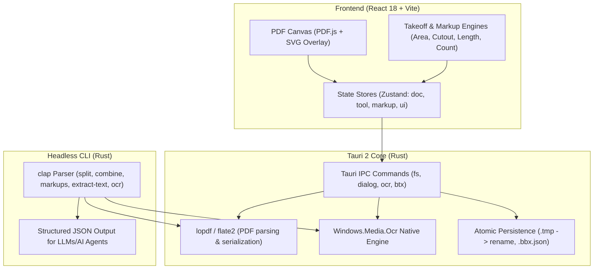

# Technical Documentation & Architecture Index

Welcome to the **pdfrev** technical documentation tree.

> [!NOTE]
> **Language Note for International Contributors:**
> The primary user-facing documentation, README, and CLI reference are written in English.
> The architectural decision records (ADRs) in [`docs/DECISIONS/`](DECISIONS/) and the feature test titles in [`PARITY.md`](../PARITY.md) are preserved in Spanish because they are part of a strict automated parity matrix (`scripts/parity-check.mjs`) that cross-checks Vitest and Playwright test descriptions literally character-by-character.

---

## 🧭 Documentation Map

| Document | Purpose & Scope | Language |
|---|---|---|
| In-App Features Guide | In-app user and developer guide for all takeoff, markup, and editing capabilities ([ADR-0100](DECISIONS/ADR-0100-guia-de-funciones.md)). | English (`src/core/help/featureGuide.ts`) |
| [`PARITY.md`](../PARITY.md) | Canonical parity matrix mapping 390+ shipped features to their exact automated unit/integration test titles. | Spanish (enforced by `parity-check.mjs`) |
| [`docs/STATUS.md`](STATUS.md) | Live status tracking of engineering phases, benchmarks, and known debts. | Spanish |
| [`docs/SCOPE.md`](SCOPE.md) | Strict IN/OUT scope definition to prevent feature creep. | Spanish |
| [`docs/DESIGN.md`](DESIGN.md) | UI/UX design specifications, color tokens, typography, and density metrics. | Spanish |
| [`docs/DECISIONS/`](DECISIONS/) | 136 Architecture Decision Records (ADRs) documenting rationale, tradeoffs, and evidence from ADR-0001 to ADR-0136. | Spanish |

---

## 🛠️ Key Developer Verification Commands

Before submitting pull requests or merging changes, run the project quality gates from the repository root:

```powershell
# 1. Parity Check: Verifies that every scenario in PARITY.md is backed by a live test
node scripts/parity-check.mjs

# 2. Complete Quality Suite: Runs TypeScript check, Vitest unit suite, bundle cap, and Cargo tests
node scripts/verify.mjs

# 3. Headless CLI Rust Suite: Runs native CLI tests (split, combine, markups, ocr)
cargo test --manifest-path src-tauri/Cargo.toml
```

---

## 🏛️ High-Level Technical Architecture



### Key Architectural Invariants
1. **Local-First & Immutability:** Never mutate user PDF buffers in-place. All file writes use atomic temporary files (`.tmp`) before moving into place to prevent corruption on crash or power loss.
2. **Sidecar Persistence (`.bbx.json`):** Annotations, calibrator scales, and takeoff metadata are dual-saved into both standard ISO 32000-1 `/Annots` objects inside the PDF and alongside the PDF as a lightweight `.bbx.json` sidecar for instant startup.
3. **Headless Automation:** Any operation that can be performed in the GUI can be driven programmatically via the `pdfrev` CLI by AI agents with `--headless --json`.
