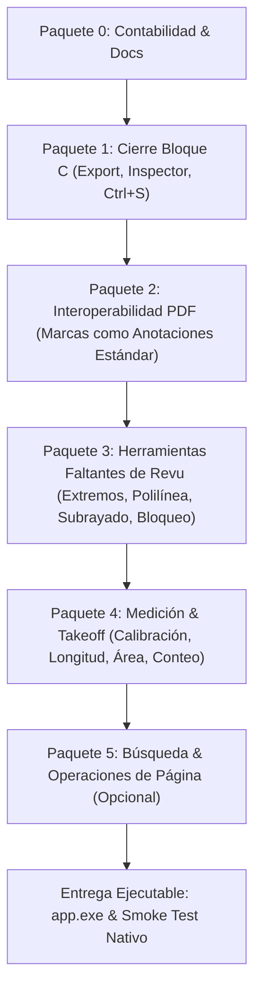

# 08 — Plan del Orquestador Autónomo: Implementación de Funciones de Revu y Motor de Interoperabilidad

- **Fecha:** 2026-10-11
- **Estado:** En ejecución
- **Base:** Commit `647b1e0` (Hito P3-A.1 completado)
- **Decisiones rectoras aprobadas por el usuario:**
  - **ADR-0011:** Opción A (PDF.js render + escritor incremental propio); crates de pdfcraft detrás de Façade en Fase 7. Estado: **Aceptado**.
  - **D-1:** El PDF es la **fuente de verdad** (anotaciones PDF estándar con `/AP`); el `.bbx.json` queda como autoguardado/recuperación y metadatos de REA.
  - **D-2:** Camino A′: cerrar Bloque C (C.4 exportación, C.5 E2E, C.6 inspector de propiedades); Capas y Sellos se trasladan a Fase 3.
  - **D-3:** Inspector de propiedades (`P2-C.6`) aprobado formalmente.
  - **D-10 / D-11:** Gobernanza de corpus y pruebas sintéticas.

---

## 1. Resumen Ejecutivo y Estrategia

El objetivo del orquestador es entregar un producto ejecutable con el cual el usuario pueda abrir la aplicación (`app.exe`) y trabajar con un conjunto completo, robusto y profesional de funciones de Bluebeam Revu, soportado por un motor de persistencia PDF ISO 32000-1 real.

El plan se estructura en **paquetes secuenciales estrictos**. Cada paquete deja la aplicación funcional, la suite de pruebas verde y la documentación alineada. Si ocurre un bloqueo insalvable en un hito, los paquetes previos permanecen utilizables y verificados.

---

## 2. Desglose Detallado de Paquetes

### Paquete 0: Contabilidad y Gobernanza
- **Objetivo:** Alinear toda la documentación del repositorio con las decisiones D-1, D-2, D-3 y ADR-0011 aceptado.
- **Acciones:**
  1. Actualizar `docs/DECISIONS/ADR-0011-motor-pdf.md` cambiando su estado a `Aceptado (aprobado por el usuario, 2026-10-11)`.
  2. Actualizar `docs/SCOPE.md`, `ROADMAP.md`, `docs/STATUS.md` y `PARITY.md` reflejando el alcance acordado.
  3. Asegurar que `.orquestador/` está ignorado en `.gitignore`.
  4. Commit: `docs(z.1): aprobar opcion A, D-1, D-2 y D-3 y alinear documentos`.

---

### Paquete 1: Cierre del Bloque C (Fase 2)
- **Hito P2-C.4: Exportación de Marcas:**
  - **CSV (RFC 4180):** Exportador con BOM UTF-8 (`\uFEFF`), retornos CRLF (`\r\n`), escape de campos con comillas, mitigación estricta de inyección de fórmulas (`=`, `+`, `-`, `@` prefijados con comilla simple `'`), respetando orden, filtros visibles y columnas personalizadas.
  - **Reporte Resumen PDF:** Generación mediante `pdf-lib` con encabezado del proyecto, métricas/totales agrupados por Estado, Autor y Tipo de marca, y tabla detallada de marcas.
  - **I/O Nativo Seguro:** Diálogo "Guardar como" nativo en Tauri y comando Rust atómico `save_export_file` con lista blanca de extensiones (`.csv`, `.pdf`).
  - **Pruebas:** Tests unitarios e integración que leen los bytes reales generados.
- **Hito P2-C.6: Inspector de Propiedades:**
  - Redacción de `ADR-0012-properties-inspector-panel.md`.
  - Componente visual `PropertiesInspectorPanel`: muestra y edita atributos de la selección actual (color trazo, relleno, grosor, opacidad, estilo de trazo/guiones, tamaño de fuente, texto, autor, estado).
  - Manejo de selección múltiple con valores mixtos representados como `—`.
  - Comandos atómicos en `commandHistoryManager` con Undo/Redo individual y guardas numéricas contra `NaN`.
- **Atajo `Ctrl+S` y Botón Guardar:**
  - Comprobación y creación de listener global para `Ctrl+S` (Windows) y botón accesible en la barra superior.
- **Hito P2-C.5: E2E del Bloque C:**
  - Pruebas Playwright (3 pasadas consecutivas en verde).
  - Cierre del Bloque C en `STATUS.md` y `PARITY.md` (verificación visual nativa en PENDIENTE).
  - Commit: `feat(p2-c): cerrar bloque C con exportacion csv/pdf, inspector de propiedades y guardado`

---

### Paquete 2: Interoperabilidad PDF (Marcas como Anotaciones ISO 32000-1)
*El hito central de la aplicación.*
- **Emisor Puro de Operadores (`src/core/pdf/`):**
  - Desacoplar la generación de flujos de dibujo de `pdfExportService` sin alterar la salida aplanada original (tests de oro inmutables).
  - Generador de Appearance Streams (`/AP` `/N`) conformes a PDF ISO 32000-1 para los 14 tipos de marcas.
- **Escritor Incremental Tipado en Producción:**
  - Adaptar y endurecer `spikes/motor/opcion-a/incremental-writer.mjs` en TypeScript estricto en `src/core/pdf/incrementalWriter.ts`.
  - Invariante dura: `output[..orig_len] == original`.
  - Mapeo exacto de diccionario para 14 tipos (`Square`, `Circle`, `Line`, `Polygon`, `PolyLine`, `FreeText`, `Text`, `Ink`, `Highlight`, `Cloud` con `/BE`, grupos `/IRT /RT /Group`), identificadores `/NM`, fechas `/M` y metadatos REA en `/REA`.
- **Comando Rust `save_pdf` Atómico:**
  - Escritura con `.tmp` + `sync_all` + `rename`.
  - Creación de copia de seguridad `<nombre>.pdf.rea-backup` la primera vez por sesión.
  - Validación antes del rename: reapertura cruzada.
  - Transporte eficiente por IPC binario (`Uint8Array` / `Vec<u8>`).
  - Detección de PDF cifrado o firmado: bloqueo de sobrescritura y ofrecimiento de "Guardar como copia".
- **Lector e Importador de Anotaciones PDF:**
  - Al abrir PDF, parsear anotaciones existentes. Propias con clave `/REA` leídas con máxima fidelidad; foráneas soportadas como best-effort; no soportadas como solo lectura.
  - Render dual con `AnnotationMode.DISABLE` en PDF.js + overlay de marcas de REA.
  - Soporte de `/StateModel Review` estándar.
- **Generación de Muestra:**
  - Generar `plan/interop/muestra-rea.pdf` con un ejemplo de cada tipo y estado para certificación del usuario.
- **Pruebas:** Unitarias, round-trip identidad, Rust atómico y E2E (3 pasadas).
- **Commit:** `feat(p3-interop): persistencia incremental en pdf con anotaciones estandar y apariencia /AP`

---

### Paquete 3: Herramientas Faltantes de Revu (Bloque H)
- **Nuevas herramientas de marcado técnico:**
  - Flecha y línea con extremos configurables (`/LE` = `/OpenArrow`, `/ClosedArrow`, `/Circle`, etc.).
  - Polilínea abierta (`PolyLine`).
  - Subrayado y tachado de texto (`Underline`, `StrikeOut`) integrados con `TextLayer`.
  - Operaciones de portapapeles: Copiar (`Ctrl+C`), Pegar (`Ctrl+V`), Duplicar (`Ctrl+D`), con soporte multipágina.
  - Bloquear marca (`/F 1` / locked): prevención de edición y arrastre accidental.
- **Pruebas y Commits:** Comandos con undo, persistencia en `/AP` y tests asociados.

---

### Paquete 4: Medición Básica para Takeoff (Fase 4 Subconjunto)
- **Calibración y Escala:**
  - Herramienta de calibración por página (dos clics en puntos conocidos + entrada de dimensión real).
  - Unidades soportadas: `m`, `cm`, `mm`, `ft`, `in`.
  - Guardas estrictas contra 0 y `NaN`.
  - Indicador visual de escala en barra inferior.
- **Herramientas de Medición:**
  - Longitud, Polilínea de medida (longitud acumulada), Área poligonal y rectangular con perímetro, y Conteo (Count markups).
  - Columnas `Medida` y `Unidad` en `MarkupsList` con agregación de totales.
  - Inclusión en exportación CSV.
  - Test de oro: verificación de tolerancia en rectángulo sintético 300×200 pt bajo rotaciones (0°, 90°, 180°, 270°).

---

### Paquete 5: Búsqueda y Operaciones de Página (Condicional)
- Búsqueda de texto integrada en `TextLayer` con navegación y resaltado.
- Operaciones de página: rotar página (90° horaria/antihoraria), eliminar página, insertar página en blanco, extraer página, con actualización consistente de `pageIndex` y referencias `/Annots`.

---

### Entrega Ejecutable y Cierre
- Compilación de `app.exe` en `src-tauri\target\release\` o `src-tauri\target\smoke\`.
- Ejecución de prueba de humo nativa.
- Elaboración de informe final auditado con evidencias literales de disco.
