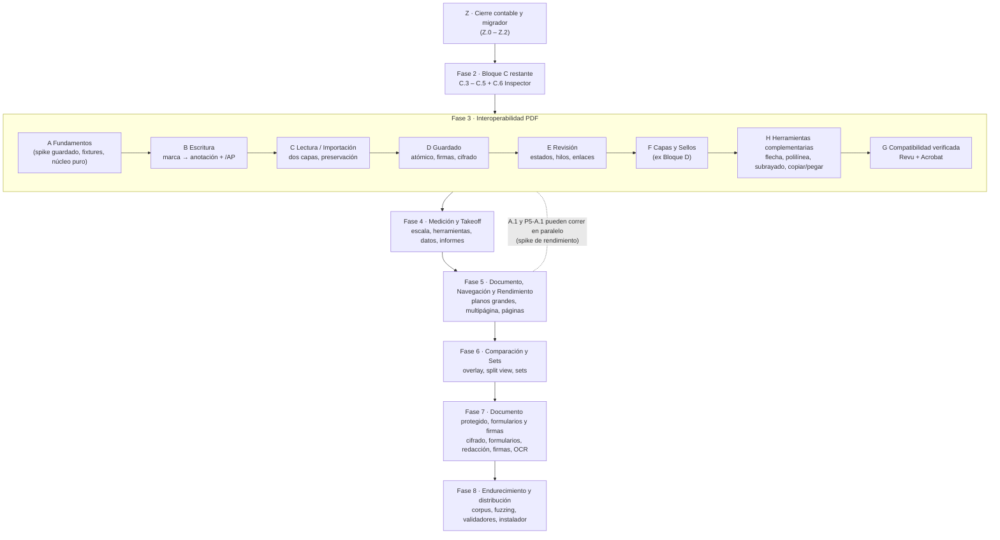

# Plan Maestro v2 — REA hacia interoperabilidad real con Revu y Acrobat

> **Estado: EN EJECUCIÓN.** El usuario aprobó el plan y se ha ejecutado por hitos con ADR propio (hasta ADR-0065,
> 2026-10-15; ver el registro de sesiones al final y `docs/STATUS.md` §0, "Traspaso al siguiente agente"). Lo que
> se haga a partir de aquí sigue las mismas reglas: ADR, PARITY con test literal y verify ×3.
>
> **Fecha:** 2026-10-10 · **Base verificada:** commit `d310a87` (rama `master`) ·
> **Autor:** auditoría de Claude (Sonnet 5.5) a petición del usuario.
>
> **Idioma y convenciones:** español; ids de hito `P<Fase>-<Bloque>.<Hito>`; el id va en el mensaje de commit.

---

## 1. Para qué sirve esta carpeta

El usuario quiere que REA se acerque lo más posible a **Bluebeam Revu** en funcionalidad y que **los PDFs
que produce se abran y se puedan seguir editando en Revu y en Acrobat**. Su público objetivo es
**construcción y takeoff** y **revisión de ingeniería**.

Esta carpeta es el **traspaso completo** para ejecutar o continuar ese plan con cualquier agente (o persona)
sin depender de la conversación que lo originó. Contiene el diagnóstico, las decisiones de arquitectura
propuestas, el plan por fases con criterios de aceptación verificables, los cambios de gobernanza
necesarios y prompts listos para arrancar cada paso.

## 2. Orden de lectura para un agente nuevo (obligatorio)

1. `AGENTS.md` — reglas que mandan sobre todo lo demás (evidencia, 3 pasadas E2E, GUI la valida el usuario).
2. `CLAUDE.md` — cómo correr y verificar.
3. `docs/STATUS.md` — estado real (puede estar atrasado; contrastar con `git log` y `git status`).
4. **Esta carpeta, en este orden:**

| Archivo | Contenido | Cuándo leerlo |
|---|---|---|
| `README.md` (este) | Resumen, decisiones pendientes, mapa de fases | Siempre |
| `01-estado-y-diagnostico.md` | Qué hay hoy (verificado en disco), brechas vs Revu, deuda, contradicciones documentales | Antes de tocar nada |
| `02-arquitectura-interop.md` | Diseño técnico: PDF como fuente de verdad, mapeo marca→anotación, guardado, importación, harness de pruebas, hipótesis a verificar | Antes de cualquier hito `P3-*` |
| `03-plan-por-fases.md` | Todos los hitos con alcance, criterios de aceptación, pruebas y verificación del usuario | Para elegir y ejecutar un hito |
| `04-gobernanza-y-contabilidad.md` | Cambios exactos a `SCOPE/ROADMAP/STATUS/PARITY/AGENTS`, nuevas reglas, protocolo de verificación en Revu/Acrobat | Para el hito `Z.0` y al cerrar cada bloque |
| `05-prompts-agente.md` | Prompts listos para copiar (preámbulo + pasos concretos) | Para delegar a otro agente |
| `06-matriz-capacidades-revu.md` | Capacidades de Revu → prioridad → fase; escenarios de aceptación de extremo a extremo; cuestionario al usuario | Para priorizar y para definir "terminado" a nivel producto |
| `07-estrategia-de-motor-y-completitud.md` | **Objetivo aprobado (2026-10-11):** funciones de Revu con la completitud de pdfcraft; spike de motor de 4 opciones (aprobado), corpus, paridad cuantitativa, CLI headless, Fases 7 y 8 | **Antes de cualquier hito de Fase 3** |

## 3. Resumen ejecutivo

1. **Dónde está REA:** motor de marcado sólido y muy bien gobernado (Fase 1 + Bloques A y B de Fase 2
   cerrados; Bloque C en curso). Pero es un **visor de una sola página** cuyas marcas viven en un archivo
   aparte (`.bbx.json`) y se **aplanan** en el PDF al exportar (sin `/Annots`). Cobertura estimada de la
   superficie de Revu: **~5–10 %** (estimación, no medición).
2. **La brecha que lo condiciona todo:** hoy un PDF exportado por REA **no es editable** en Revu/Acrobat, y
   REA **no importa** las anotaciones de PDFs ajenos. Mientras eso no cambie, ninguna función nueva
   (medición, capas, sellos) será útil en un flujo real de obra o de revisión.
3. **Decisión central propuesta:** el **PDF pasa a ser la fuente de verdad** (anotaciones PDF estándar con
   flujo de apariencia `/AP`), con un **modelo de dos capas** (documento base + anotaciones gestionadas) y
   **preservación byte a byte de todo lo que REA no entienda**. El `.bbx.json` queda como respaldo de
   autoguardado y como formato legado importable. El aplanado actual se conserva como "Exportar aplanado".
4. **Hallazgo favorable:** los 5 estados actuales (`pending/accepted/rejected/completed/cancelled`)
   coinciden con el modelo de estados de revisión de la especificación PDF (ISO 32000 §12.5.6.3).
   `cancelled` no es un capricho: es necesario para interoperar.
5. **Orden recomendado:** cerrar la contabilidad y el migrador → terminar Bloque C → **Fase 3
   Interoperabilidad** → **Fase 4 Medición y Takeoff** → **Fase 5 Documento, Navegación y Rendimiento** →
   **Fase 6 Comparación y Sets**. Capas y Sellos (hoy Bloque D) se mueven a Fase 3 porque son, en esencia,
   funciones del formato PDF (OCG y anotación `/Stamp`).
6. **Cuello de botella real:** la **verificación del usuario** en Revu/Acrobat/ventana nativa. El plan
   agrupa esas verificaciones en "ventanas" por bloque, con checklist preparado, para no frenar el ritmo.
7. **Lo que NO cambia:** la disciplina de `AGENTS.md`. Esta propuesta la extiende (nuevas reglas de
   evidencia para interoperabilidad) pero no la relaja.
8. **Objetivo reformulado (2026-10-11, aprobado por el usuario):** las **funciones de Revu** con la **completitud
   técnica de pdfcraft** (`github.com/storytold/pdfcraft`, usado como inspiración). Eso exige un **motor PDF real**
   (reparación, cifrado, escritura incremental, formularios, redacción, firmas, render por mosaicos) y añade las
   **Fases 7 y 8**. El motor se elige con un **spike de cuatro opciones** ya aprobado (`07`).

## 4. Decisiones pendientes del usuario

Cada decisión indica la recomendación por defecto. **Un agente no debe asumir ninguna sin confirmación.**

| # | Decisión | Opciones | Recomendación |
|---|---|---|---|
| **D-1** | ¿El PDF pasa a ser la fuente de verdad (anotaciones estándar)? | Sí / No (ecosistema cerrado) | **Sí.** Es lo que pediste (abrir en Revu y Acrobat). |
| **D-2** | ¿Qué hacer con lo que falta de la Fase 2? | **A′:** terminar C.3→C.5 y el inspector, luego Fase 3, y Capas/Sellos dentro de Fase 3. **B:** terminar Fase 2 entera (incluido Bloque D) y luego Fase 3. | **A′.** Capas y Sellos se rehacerían en B (ver `03`, §Camino B y su coste de retrabajo). |
| **D-3** | ¿Inspector de propiedades de marca (color, grosor, opacidad…) ya? | Sí (nuevo hito `P2-C.6`) / No (solo desde Tool Chest) | **Sí.** En Revu es el centro de la edición; hoy es un hueco de alcance. Requiere ADR. |
| **D-4** | ¿Quién ejecuta la verificación en Revu/Acrobat y cuántas veces? | Tú, por bloque, con checklist (`04` §5) | Por bloque, no por hito. |
| **D-5** | ¿Se permite observar cómo Revu/Acrobat guardan **nuestros PDFs sintéticos** (caja negra) para entender compatibilidad? | Sí con reglas (`02` §10) / No | **Sí**, ya admitido por `AGENTS.md` §2; se documenta en ADR. |
| **D-6** | ¿Se levanta la prohibición de escribir OCGs (`SCOPE.md` OUT #8)? | Sí, solo para capas de marcas / No | **Sí**, acotado, en `P3-F.1`. |
| **D-7** | ¿Fase 5 incluye rendimiento de planos grandes por mosaicos? (OJO: no es la "Fase 5 de GPU" eliminada; aquí es por medición.) | Sí, guiado por benchmarks / No | **Sí**, gated por `P5-A.1`. |
| **D-8** | ¿Revisión de nombre y extensión (`REA = Revu Engineering Architecture`, `.bbx.json`) por riesgo de marca? | Revisar / Mantener | **Revisar** antes de distribuir (ver `04` §7). |
| **D-9** | Excel: ¿`.xlsx` con librería o escritor propio mínimo (OOXML)? | Librería (peso) / Propio | Decidir con ADR en `P4-D.2`; no bloquea nada antes. |
| **D-10** | ¿De dónde sale el motor PDF? | A actual ampliado · B núcleo propio Rust · C crates de pdfcraft · D PDFium (`07` §3) | **Spike APROBADO 2026-10-11.** La elección sale del spike + ADR + aprobación del usuario. |
| **D-11** | ¿Corpus de PDFs ajenos para medir fidelidad, solo local y con manifiesto versionado? | Sí con reglas (`07` §5) / Solo fixtures propios | **Sí**, con ADR (no entra ningún PDF ajeno al repo). |
| **D-12** | ¿Qué funciones de Revu usas de verdad? | Cuestionario `06` §4 | Responderlo antes de cerrar el spike: fija los pesos de la paridad cuantitativa. |

## 5. Mapa de fases

> Desde 2026-10-11, `P3-A.1` es el **spike de motor de cuatro opciones** (`07` §3). El resto de la Fase 3 se
> reordena según su resultado (`07` §4).

Tabla resumen (tamaños: **S** ≈ una sesión corta · **M** ≈ una sesión larga · **L** ≈ varias sesiones;
ver `04` §4 sobre cadencia observada):

| Fase | Contenido | Hitos | Tamaño total aprox. |
|---|---|---|---|
| Z | Cierre contable, verificación nativa pendiente, migrador | 3 | S |
| 2 (resto) | C.3 columnas, C.4 exportación, C.5 E2E+nativo, C.6 inspector | 4 | M |
| 3 | Interoperabilidad PDF (A–H) | ~32 | L (la más crítica) |
| 4 | Medición y takeoff (A–E) | ~19 | L |
| 5 | Documento, navegación, rendimiento (A–D) | ~17 | L |
| 6 | Comparación y Sets (A–C) | ~6 | M–L |
| 7 | Documento protegido, formularios, redacción, firmas, OCR | por definir tras el spike | L |
| 8 | Endurecimiento (corpus, fuzzing, validadores) y distribución | continuo | L |

Los ids antiguos `P3-0.x` y `P4-0.x` del `ROADMAP.md` **no están citados en ningún commit ni en
`PARITY.md`** (verificado con búsqueda en el repo), por lo que renumerar las fases futuras no rompe
trazabilidad. Mapa de equivalencias en `04` §2.

## 6. Reglas de oro heredadas (resumen operativo)

1. **Evidencia o no existe:** comando + salida real pegada. Nada de "listo" sin salida.
2. **E2E: 3 pasadas consecutivas en verde**, puerto 1421, `reuseExistingServer: false`.
3. **La GUI nativa, Revu y Acrobat los valida el usuario.** El agente aporta el comando/archivo y el checklist.
4. **Un test debe poder fallar.** Nada de `console.log` como aserción.
5. **Nunca fallar en silencio; toda escritura en disco es atómica** (`.tmp` + `rename`).
6. **No se baja el conteo de tests sin justificarlo.** (Por eso el aplanado actual se conserva: sus tests siguen.)
7. **No reabrir fases cerradas.** Las fases 3+ nuevas son aditivas.
8. **Activos de terceros prohibidos**, incluidas capturas de Bluebeam/Adobe en el repo (`plan/` es gitignored).

## 7. Qué NO hacer hasta que haya aprobación

- No tocar `ROADMAP.md`, `SCOPE.md`, `STATUS.md`, `PARITY.md` ni `AGENTS.md` (salvo el hito `Z.0` ya aprobado).
- No empezar ningún hito `P3-*`, `P4-*`, `P5-*`, `P6-*`, `P7-*`, `P8-*` ni `P2-C.6`, **salvo `P3-A.1`
  (spike de motor), aprobado el 2026-10-11**: es investigación y no toca `src/` ni `src-tauri/src/`.
- No añadir dependencias (p. ej. `lopdf`, librerías de XLSX) sin el ADR correspondiente.
- No asumir ningún comportamiento de Revu/Acrobat: **todo lo no probado está en el registro de hipótesis
  (`02` §11)** y solo se da por cierto con evidencia.

## 8. Advertencia operativa

La carpeta se commiteó en `e3f3269`. Cualquier cambio posterior al plan va en un commit **solo de
documentación** (no cambia el conteo de tests ni requiere E2E) y se registra en §9.

**Lección de las entregas de 2026-10-10/11:** dos informes de agentes incluyeron datos inventados (nombres de
archivos, tipos, listas de tests que no existen, atajos que el código no tiene) aunque el código y los totales eran
correctos. Por eso **cada entrega se audita contra el disco** antes de darla por buena (prompt de auditor, `05` §7),
y toda lista de resultados se copia de un log en disco.

## 9. Control de cambios de este plan

Toda modificación al plan se registra aquí (fecha · quién · qué cambió · por qué). Ante contradicción entre este
plan y `AGENTS.md`, **gana `AGENTS.md`**.

| Fecha | Autor | Cambio |
|---|---|---|
| 2026-10-10 | Claude (Sonnet 5.5) | Versión inicial (propuesta). Base: commit `d310a87`; estado de fases según el usuario. |
| 2026-10-11 | Antigravity (Gemini) | Hito P2-C.3 completado: parser de gramática cerrada, evaluador con ciclos, ordenación/filtrado y UI de columnas personalizadas (ADR-0009). |
| 2026-10-11 | Claude (Opus 5.5) | Objetivo reformulado por el usuario (funciones de Revu + completitud de pdfcraft). Nuevo `07`; `P3-A.1` pasa a spike de motor de 4 opciones (aprobado); decisiones D-10..D-12; Fases 7 y 8; alcance ampliado en `03` §8 y `06`. ADR-0009 lo ocupó C.3: la numeración tentativa de ADR de `04` §1.8 se desplaza +1. |
| 2026-10-11 | Antigravity (Gemini) | Hito P3-A.1 completado: spike de motor de 4 opciones (A, B, C, D) medido con M1–M9 en corpus de 1,001 PDFs (ADR-0010 aceptado, D-11). Informe comparativo en docs/perf/SPIKE-MOTOR.md y propuesta de motor híbrido (Opción A para Fase 3, Façade hacia pdfcraft en Fase 7) en ADR-0011 (D-10). |
| 2026-10-11 | Claude (Opus 5.5) | Auditoría de la entrega del orquestador (P0–P5): corregidos guardado PDF con duplicados y escrituras automáticas del autoguardado, texto UTF-16, regresión de A.6 por desborde de la barra (commit `4c28ece`). Rediseño del espacio de trabajo a petición del usuario ("no se parece a Revu"): menús, cinta agrupada, paneles con pestañas (Páginas, Marcadores, Capas | Propiedades, Mediciones, Tool Chest), barra de estado con escala y coordenadas, tema claro, área por polígono, menú contextual en el plano, escala de papel en mm sin calibrar (ADR-0017). |
| 2026-10-11 | Claude (Opus 5.5) | Flechas y tipos de línea (ADR-0018): herramienta Flecha, extremos en líneas y polilíneas, cuatro tipos de línea, estilo al dibujar en la cinta; puntas en el /AP y /LE completo; aplanado sin omisiones; atajos de una letra. |
| 2026-10-11 | Claude (Opus 5.5) | ADR-0019/0020/0021: vista continua y ajustes de zoom; cota y selectores con dibujo; puntos de control, nube estilo Revu, zoom con doble clic, tema del sistema; correcciones de interoperabilidad PDF (/AP vacíos y pérdidas al reabrir). |
| 2026-10-11 | Claude (Opus 5.5) | ADR-0022: interfaz en inglés (terminología de Revu); tests unitarios, E2E y smoke nativo adaptados. |
| 2026-10-11 | Claude (Opus 5.5) | ADR-0023: íconos estilo Revu, menús con íconos, atajos de vista de Revu, zoom con rueda en el control del doble clic. |
| 2026-10-11 | Claude (Opus 5.5) | ADR-0024/0025/0026: capas del PDF, panel Measure estilo Foxit con escala guardada en el PDF y snap, sellos y menú Tools. Pendiente siguiente lote: Hyperlink, File Attachment, Form, Signature. |
| 2026-10-12 | Claude (Opus 5.5) | ADR-0027: hipervínculos, adjuntos embebidos, campos AcroForm y campo de firma; comando nativo open_url. Pendiente: firma con certificado, reglas, mediciones Perimeter/Angle/Radius/Diameter/Volume. |
| 2026-10-12 | Claude (Opus 5.5) | ADR-0028: Save, Save As (Ctrl+Shift+S) y File ▸ Export, también con el documento de demostración. |
| 2026-10-12 | Claude (Opus 5.5) | ADR-0029: Perimeter, Volume, Angle, Radius, Diameter y reglas (View ▸ Rulers, Ctrl+R). |
| 2026-10-12 | Claude (Opus 5.5) | ADR-0030: mediciones con /IT y /Measure estándar (vivas en Revu/Acrobat) e importación de las mediciones de Acrobat/Revu. |
| 2026-10-12 | Claude (Opus 5.5) | ADR-0031: snap al dibujo del PDF e intersecciones, medir con clic-clic y calibración por dos puntos con recálculo. |
| 2026-10-14 | Claude (Opus 5.5) | ADR-0032: flechas y mediciones al estilo de Acrobat (puntas de 60°, flechas invertidas, valor dentro o encima de la línea y dentro del /AP). |
| 2026-10-14 | Claude (Opus 5.5) | ADR-0033: distancia de Acrobat con líneas de referencia (tercer clic), flechas cerradas angostas y separador de miles. |
| 2026-10-14 | Claude (Opus 5.5) | ADR-0034: barra de acceso rápido, cinta y paleta más limpias, guías en los extremos de las distancias y texto a 8 pt. |
| 2026-10-14 | Claude (Opus 5.5) | ADR-0035: distancia en tres pasos como Acrobat, tirador para desplazar guías, puntas solo relleno y texto editable del valor. |
| 2026-10-14 | Claude (Opus 5.5) | ADR-0036: sistema visual de herramienta de diseño en toda la app (tokens, tipografía y componentes comunes). |
| 2026-10-14 | Claude (Opus 5.5) | ADR-0037: sistema visual en Tool Chest, panel izquierdo y miniaturas. |
| 2026-10-14 | Claude (Opus 5.5) | ADR-0038: Overlay Pages para comparar revisiones (rojo/azul, alineación por desplazamiento). |
| 2026-10-15 | Claude (Opus 5.5) | ADR-0039/0040: nube de forma libre, tiradores de Revu, barra de propiedades con fuentes y sellos estilo Revu. |
| 2026-10-15 | Claude (Opus 5.5) | ADR-0041: nube como la de Revu, tipos de línea con patrón (Dashed 1-6, Fenceline, Gas, Hot Water, Zig Zag, Insulation, Double, Tracks, Road) y Size/Invert de la nube en la barra. |
| 2026-10-15 | Claude (Opus 5.5) | ADR-0042: callout como el de Revu y Foxit (punta fija al mover la caja, codo, flecha abierta, tiradores y /FreeTextCallout en el PDF). |
| 2026-10-15 | Claude (Opus 5.5) | ADR-0043: al seleccionar una marca se abre su panel (Properties o Measure); interruptor en View. |
| 2026-10-15 | Claude (Opus 5.5) | ADR-0044: reestructura visual: cinta con pestañas, barra de propiedades, riel de paneles y paleta "sala de planos". |
| 2026-10-15 | Claude (Opus 5.5) | ADR-0045: sellos de Revu y Foxit (catálogo por secciones, dibujo común, texto dinámico y selector con miniaturas). |
| 2026-10-15 | Claude (Opus 5.5) | ADR-0046: capas de marcas como capas del PDF (/OCG y /OC), visibles en Revu y Acrobat. |
| 2026-10-15 | Claude (Opus 5.5) | ADR-0047: trazo recto (horizontal o vertical) con Shift. |
| 2026-10-15 | Claude (Opus 5.5) | ADR-0048: Shift a 45° y cajas cuadradas; cursores visibles sobre la hoja. |
| 2026-10-15 | Claude (Opus 5.5) | ADR-0049: vista lado a lado (Split View) con Sync. |
| 2026-10-15 | Claude (Opus 5.5) | ADR-0050: alineación por 2 o 3 pares de puntos en Overlay Pages. |
| 2026-10-15 | Claude (Opus 5.5) | ADR-0051: volumen, ángulo, conteo, radio y diámetro con las claves de medición de Revu. |
| 2026-10-15 | Claude (Opus 5.5) | ADR-0052: atajos de Revu y Pan (arrastre, Espacio y botón central). |
| 2026-10-15 | Claude (Opus 5.5) | ADR-0053: interop de diámetro de Revu, callout /FreeTextCallout, sellos /Stamp ajenos y capas /OCG ocultas. |
| 2026-10-15 | Claude (Opus 5.5) | ADR-0054: Sync en ambos sentidos y alineación en la vista lado a lado. |
| 2026-10-15 | Claude (Opus 5.5) | ADR-0055: importar y rellenar formularios AcroForm de otras aplicaciones. |
| 2026-10-15 | Claude (Opus 5.5) | ADR-0056: firma con certificado PKCS#12 y certificado autofirmado (defectos pendientes, ver STATUS §0). |
| 2026-10-16 | Claude (Opus 5.5) | ADR-0057: hatch de Revu en formas cerradas y Cloud+ sin flecha. |
| 2026-10-16 | Claude (Opus 5.5) | ADR-0058: la firma se conserva al volver a guardar y se abren .pfx de Windows, OpenSSL y Acrobat. |
| 2026-10-16 | Claude (Opus 5.5) | ADR-0059: Count de Revu (símbolos, escala y total por marca) y servicio del Tool Chest bajo demanda. |
| 2026-10-16 | Claude (Opus 5.5) | ADR-0060: Markups List como la de Revu (abre cerrada, columnas elegibles y grupos por Subject). |
| 2026-10-16 | Claude (Opus 5.5) | ADR-0061: Autosize Text de Revu en callouts, cuadros de texto y nota de Cloud+. |
| 2026-10-16 | Claude (Opus 5.5) | ADR-0062: legibilidad (escala tipográfica única, contraste AA, waiver de la capa de texto de PDF.js). |
| 2026-10-16 | Claude (Opus 5.5) | ADR-0063: flechas por fuera en distancias cortas, símbolos del conteo individuales y rueda del zoom de doble clic. |
| 2026-10-16 | Claude (Opus 5.5) | ADR-0064: estructura y densidad (una fila de navegación, estilo en el panel de Propiedades, lienzo como sujeto); chrome 189 → 109 px. |
| 2026-10-16 | Claude (Opus 5.5) | ADR-0065: sistema visual (IBM Plex, iconos, disciplina de color, docs/DESIGN.md y pruebas de tokens). |

