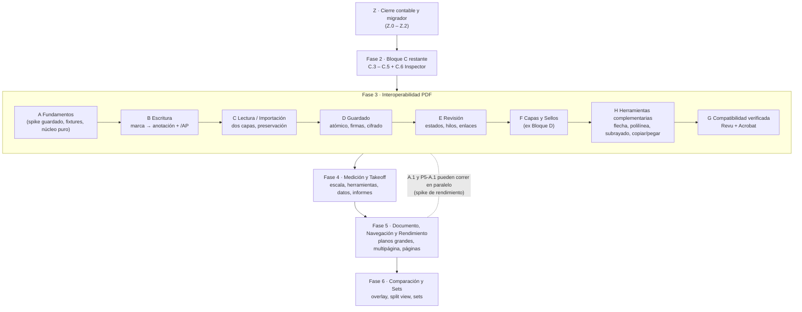

# Plan Maestro v2 — REA hacia interoperabilidad real con Revu y Acrobat

> **Estado: PROPUESTA — NO APROBADA.** Nada de lo que describe esta carpeta se implementa hasta que el
> usuario lo apruebe (regla `AGENTS.md` §9: lo que no está en `docs/SCOPE.md` requiere ADR + aprobación
> explícita). Este plan **no sustituye** a `ROADMAP.md`, `SCOPE.md`, `STATUS.md` ni `PARITY.md` hasta que
> se ejecute el hito `Z.0` (ver `04-gobernanza-y-contabilidad.md`).
>
> **Fecha:** 2026-10-10 · **Base verificada:** commit `d310a87` (rama `master`) ·
> **Autor:** auditoría de Claude (Sonnet 5.5) a petición del usuario.
>
> **Idioma y convenciones:** español; ids de hito `P<Fase>-<Bloque>.<Hito>`; el id va en el mensaje de commit.

---

## 1. Para qué sirve esta carpeta

El usuario quiere que REA se acerque lo más posible a **Bluebeam Revu** en funcionalidad y que **los PDFs
que produce se abran y se puedan seguir editando en Revu y en Acrobat**. Su público objetivo es
**construcción y takeoff** y **revisión de ingeniería**.

Esta carpeta es el **traspaso completo** para ejecutar o continuar ese plan con cualquier agente (o persona)
sin depender de la conversación que lo originó. Contiene el diagnóstico, las decisiones de arquitectura
propuestas, el plan por fases con criterios de aceptación verificables, los cambios de gobernanza
necesarios y prompts listos para arrancar cada paso.

## 2. Orden de lectura para un agente nuevo (obligatorio)

1. `AGENTS.md` — reglas que mandan sobre todo lo demás (evidencia, 3 pasadas E2E, GUI la valida el usuario).
2. `CLAUDE.md` — cómo correr y verificar.
3. `docs/STATUS.md` — estado real (puede estar atrasado; contrastar con `git log` y `git status`).
4. **Esta carpeta, en este orden:**

| Archivo | Contenido | Cuándo leerlo |
|---|---|---|
| `README.md` (este) | Resumen, decisiones pendientes, mapa de fases | Siempre |
| `01-estado-y-diagnostico.md` | Qué hay hoy (verificado en disco), brechas vs Revu, deuda, contradicciones documentales | Antes de tocar nada |
| `02-arquitectura-interop.md` | Diseño técnico: PDF como fuente de verdad, mapeo marca→anotación, guardado, importación, harness de pruebas, hipótesis a verificar | Antes de cualquier hito `P3-*` |
| `03-plan-por-fases.md` | Todos los hitos con alcance, criterios de aceptación, pruebas y verificación del usuario | Para elegir y ejecutar un hito |
| `04-gobernanza-y-contabilidad.md` | Cambios exactos a `SCOPE/ROADMAP/STATUS/PARITY/AGENTS`, nuevas reglas, protocolo de verificación en Revu/Acrobat | Para el hito `Z.0` y al cerrar cada bloque |
| `05-prompts-agente.md` | Prompts listos para copiar (preámbulo + pasos concretos) | Para delegar a otro agente |
| `06-matriz-capacidades-revu.md` | Capacidades de Revu → prioridad → fase; escenarios de aceptación de extremo a extremo; cuestionario al usuario | Para priorizar y para definir "terminado" a nivel producto |

## 3. Resumen ejecutivo

1. **Dónde está REA:** motor de marcado sólido y muy bien gobernado (Fase 1 + Bloques A y B de Fase 2
   cerrados; Bloque C en curso). Pero es un **visor de una sola página** cuyas marcas viven en un archivo
   aparte (`.bbx.json`) y se **aplanan** en el PDF al exportar (sin `/Annots`). Cobertura estimada de la
   superficie de Revu: **~5–10 %** (estimación, no medición).
2. **La brecha que lo condiciona todo:** hoy un PDF exportado por REA **no es editable** en Revu/Acrobat, y
   REA **no importa** las anotaciones de PDFs ajenos. Mientras eso no cambie, ninguna función nueva
   (medición, capas, sellos) será útil en un flujo real de obra o de revisión.
3. **Decisión central propuesta:** el **PDF pasa a ser la fuente de verdad** (anotaciones PDF estándar con
   flujo de apariencia `/AP`), con un **modelo de dos capas** (documento base + anotaciones gestionadas) y
   **preservación byte a byte de todo lo que REA no entienda**. El `.bbx.json` queda como respaldo de
   autoguardado y como formato legado importable. El aplanado actual se conserva como "Exportar aplanado".
4. **Hallazgo favorable:** los 5 estados actuales (`pending/accepted/rejected/completed/cancelled`)
   coinciden con el modelo de estados de revisión de la especificación PDF (ISO 32000 §12.5.6.3).
   `cancelled` no es un capricho: es necesario para interoperar.
5. **Orden recomendado:** cerrar la contabilidad y el migrador → terminar Bloque C → **Fase 3
   Interoperabilidad** → **Fase 4 Medición y Takeoff** → **Fase 5 Documento, Navegación y Rendimiento** →
   **Fase 6 Comparación y Sets**. Capas y Sellos (hoy Bloque D) se mueven a Fase 3 porque son, en esencia,
   funciones del formato PDF (OCG y anotación `/Stamp`).
6. **Cuello de botella real:** la **verificación del usuario** en Revu/Acrobat/ventana nativa. El plan
   agrupa esas verificaciones en "ventanas" por bloque, con checklist preparado, para no frenar el ritmo.
7. **Lo que NO cambia:** la disciplina de `AGENTS.md`. Esta propuesta la extiende (nuevas reglas de
   evidencia para interoperabilidad) pero no la relaja.

## 4. Decisiones pendientes del usuario

Cada decisión indica la recomendación por defecto. **Un agente no debe asumir ninguna sin confirmación.**

| # | Decisión | Opciones | Recomendación |
|---|---|---|---|
| **D-1** | ¿El PDF pasa a ser la fuente de verdad (anotaciones estándar)? | Sí / No (ecosistema cerrado) | **Sí.** Es lo que pediste (abrir en Revu y Acrobat). |
| **D-2** | ¿Qué hacer con lo que falta de la Fase 2? | **A′:** terminar C.3→C.5 y el inspector, luego Fase 3, y Capas/Sellos dentro de Fase 3. **B:** terminar Fase 2 entera (incluido Bloque D) y luego Fase 3. | **A′.** Capas y Sellos se rehacerían en B (ver `03`, §Camino B y su coste de retrabajo). |
| **D-3** | ¿Inspector de propiedades de marca (color, grosor, opacidad…) ya? | Sí (nuevo hito `P2-C.6`) / No (solo desde Tool Chest) | **Sí.** En Revu es el centro de la edición; hoy es un hueco de alcance. Requiere ADR. |
| **D-4** | ¿Quién ejecuta la verificación en Revu/Acrobat y cuántas veces? | Tú, por bloque, con checklist (`04` §5) | Por bloque, no por hito. |
| **D-5** | ¿Se permite observar cómo Revu/Acrobat guardan **nuestros PDFs sintéticos** (caja negra) para entender compatibilidad? | Sí con reglas (`02` §10) / No | **Sí**, ya admitido por `AGENTS.md` §2; se documenta en ADR. |
| **D-6** | ¿Se levanta la prohibición de escribir OCGs (`SCOPE.md` OUT #8)? | Sí, solo para capas de marcas / No | **Sí**, acotado, en `P3-F.1`. |
| **D-7** | ¿Fase 5 incluye rendimiento de planos grandes por mosaicos? (OJO: no es la "Fase 5 de GPU" eliminada; aquí es por medición.) | Sí, guiado por benchmarks / No | **Sí**, gated por `P5-A.1`. |
| **D-8** | ¿Revisión de nombre y extensión (`REA = Revu Engineering Architecture`, `.bbx.json`) por riesgo de marca? | Revisar / Mantener | **Revisar** antes de distribuir (ver `04` §7). |
| **D-9** | Excel: ¿`.xlsx` con librería o escritor propio mínimo (OOXML)? | Librería (peso) / Propio | Decidir con ADR en `P4-D.2`; no bloquea nada antes. |

## 5. Mapa de fases



Tabla resumen (tamaños: **S** ≈ una sesión corta · **M** ≈ una sesión larga · **L** ≈ varias sesiones;
ver `04` §4 sobre cadencia observada):

| Fase | Contenido | Hitos | Tamaño total aprox. |
|---|---|---|---|
| Z | Cierre contable, verificación nativa pendiente, migrador | 3 | S |
| 2 (resto) | C.3 columnas, C.4 exportación, C.5 E2E+nativo, C.6 inspector | 4 | M |
| 3 | Interoperabilidad PDF (A–H) | ~32 | L (la más crítica) |
| 4 | Medición y takeoff (A–E) | ~19 | L |
| 5 | Documento, navegación, rendimiento (A–D) | ~17 | L |
| 6 | Comparación y Sets (A–C) | ~6 | M–L |

Los ids antiguos `P3-0.x` y `P4-0.x` del `ROADMAP.md` **no están citados en ningún commit ni en
`PARITY.md`** (verificado con búsqueda en el repo), por lo que renumerar las fases futuras no rompe
trazabilidad. Mapa de equivalencias en `04` §2.

## 6. Reglas de oro heredadas (resumen operativo)

1. **Evidencia o no existe:** comando + salida real pegada. Nada de "listo" sin salida.
2. **E2E: 3 pasadas consecutivas en verde**, puerto 1421, `reuseExistingServer: false`.
3. **La GUI nativa, Revu y Acrobat los valida el usuario.** El agente aporta el comando/archivo y el checklist.
4. **Un test debe poder fallar.** Nada de `console.log` como aserción.
5. **Nunca fallar en silencio; toda escritura en disco es atómica** (`.tmp` + `rename`).
6. **No se baja el conteo de tests sin justificarlo.** (Por eso el aplanado actual se conserva: sus tests siguen.)
7. **No reabrir fases cerradas.** Las fases 3+ nuevas son aditivas.
8. **Activos de terceros prohibidos**, incluidas capturas de Bluebeam/Adobe en el repo (`plan/` es gitignored).

## 7. Qué NO hacer hasta que haya aprobación

- No tocar `ROADMAP.md`, `SCOPE.md`, `STATUS.md`, `PARITY.md` ni `AGENTS.md` (salvo el hito `Z.0` ya aprobado).
- No empezar ningún hito `P3-*`, `P4-*`, `P5-*`, `P6-*` ni `P2-C.6`.
- No añadir dependencias (p. ej. `lopdf`, librerías de XLSX) sin el ADR correspondiente.
- No asumir ningún comportamiento de Revu/Acrobat: **todo lo no probado está en el registro de hipótesis
  (`02` §11)** y solo se da por cierto con evidencia.

## 8. Advertencia operativa

Esta carpeta se creó mientras otras sesiones trabajaban en el árbol (`P2-C.2`, E2E). Son archivos **nuevos
y sin commitear**. Antes de que cualquier agente haga `git add -A`, conviene commitear esta carpeta aparte:

```powershell
git add docs/plan-v2
git commit -m "docs(plan): plan maestro v2 propuesto (interoperabilidad, medicion, navegacion)"
```

(Un commit de solo documentación no cambia el conteo de tests ni requiere E2E.)

## 9. Control de cambios de este plan

Toda modificación al plan se registra aquí (fecha · quién · qué cambió · por qué). Ante contradicción entre este
plan y `AGENTS.md`, **gana `AGENTS.md`**.

| Fecha | Autor | Cambio |
|---|---|---|
| 2026-10-10 | Claude (Sonnet 5.5) | Versión inicial (propuesta). Base: commit `d310a87`; estado de fases según el usuario. |
| 2026-10-11 | Antigravity (Gemini) | Hito P2-C.3 completado: parser de gramática cerrada, evaluador con ciclos, ordenación/filtrado y UI de columnas personalizadas (ADR-0009). |
